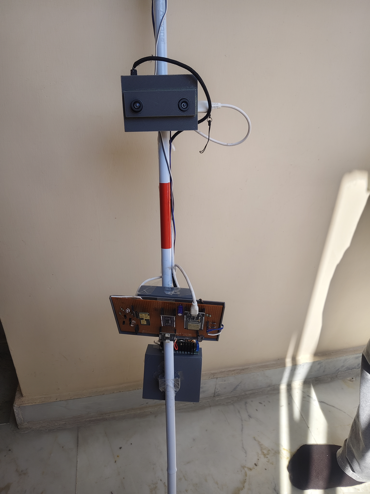
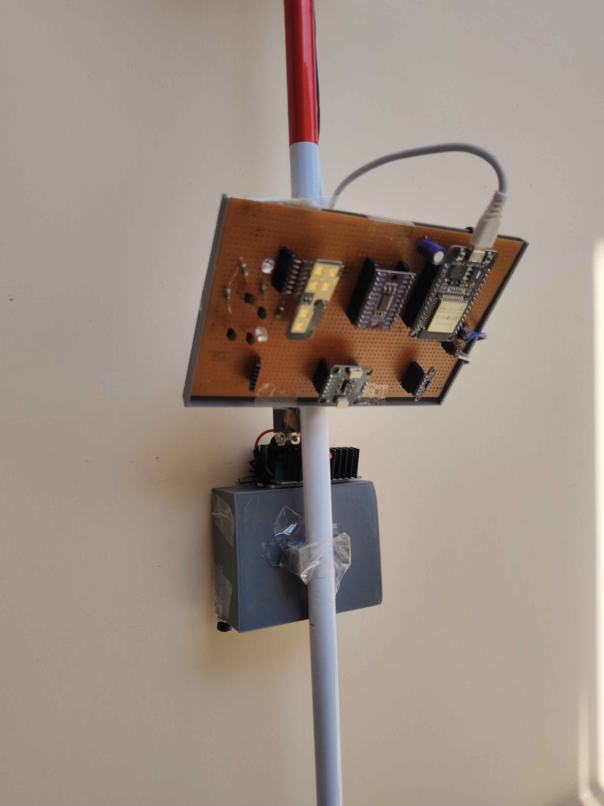
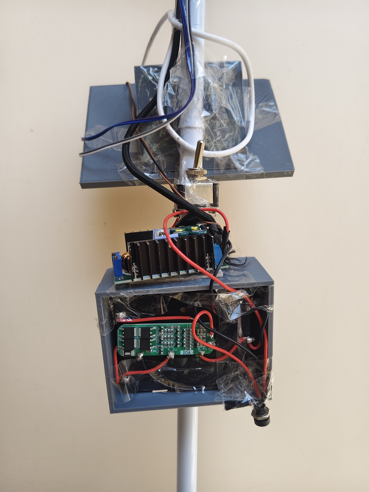

# SamDrishti: Smart Assistive Navigation System

## Overview

SamDrishti is an assistive mobility platform designed to empower visually impaired individuals with spatial awareness, hazard detection, and navigation assistance. Rather than relying solely on single-point proximity sensors or camera-only systems, SamDrishti implements a distributed multi-sensor architecture consisting of a smart walking stick and a wireless Bluetooth audio interface.

The system fuses complementary sensory modalities:
* Stereo Computer Vision on an edge processor (Raspberry Pi 5) for real-time semantic object classification and 3D depth localization.
* Millimeter-Wave (mmWave) Radar on an embedded controller (ESP32) for all-weather, low-latency detection of approaching dynamic obstacles, pedestrians, and vehicles.
* Time-of-Flight (ToF) multi-zone and single-point sensors for ground elevation mapping, curb detection, drop-off/pothole detection, and overhead clearances.
* Dual feedback channels: Haptic vibration cues directly on the cane handle and prioritized natural speech alerts delivered wirelessly via Bluetooth A2DP.

---

## Prototype Demonstration

The smart walking stick prototype integrates stereo vision, multi-sensor detection, power management, and real-time processing directly on the cane structure.

| Front View (Full Assembly) | Sensor Board & Microcontroller | Power System & Stepper/BMS |
| :---: | :---: | :---: |
|  |  |  |
| **Stereo Camera and Sensor Head**<br>IMX219 binocular camera mounted at upper elevation, sensor hub, and central enclosure. | **Sensor Subsystem & ESP32**<br>Custom prototyping board hosting ESP32 controller, ToF sensors, and signal lines. | **Power & Battery Management**<br>Li-ion cells with 20A BMS, step-down voltage regulator with heatsink, and power switch. |

---

## System Architecture and Workflow

The system operates across two interconnected computing nodes: an ESP32 microcontroller and a Raspberry Pi 5 single-board computer.

```
+-------------------------------------------------------------------------+
|                              SAMDRISHTI                                 |
+-------------------------------------------------------------------------+
                                    |
        +---------------------------+---------------------------+
        |                                                       |
        v                                                       v
+-------------------------------+               +-------------------------------+
|      ESP32 Microcontroller    |               |        Raspberry Pi 5         |
|         (Stick Node)          |               |         (Compute Node)        |
+-------------------------------+               +-------------------------------+
| * mmWave Radar (RD-03D)       |               | * Stereo Camera (IMX219-83)   |
| * ToF Multi-zone (VL53L5CX)   |               | * Rectification & Disparity   |
| * ToF Array (VL53L0X)         |               | * YOLO Object Detection (NCNN)|
| * Ultrasonic Sensor           |               | * Temporal Depth Smoothing    |
| * IMU (MPU6050)               |               | * Priority Arbitration Engine |
| * Haptic Vibration Motors (x4)|               | * Offline TTS / Audio Stream  |
+-------------------------------+               +-------------------------------+
        |                                                       |
        | JSON Telemetry (UART / USB @ 115200)                  |
        +------------------------------------------------------>+
                                                                |
                                                                v
                                                +-------------------------------+
                                                |     Bluetooth Audio Sink      |
                                                |  (User Earpiece / Headset)    |
                                                +-------------------------------+
```

### 1. ESP32 Sensor Node (Data Acquisition and Immediate Haptic Alerting)
The ESP32-WROOM-32 handles high-frequency hardware polling and immediate physical safety reactions:
* Moving Object Detection: Ai-Thinker RD-03D mmWave radar modules identify objects approaching from the front or rear with relative velocity classification.
* Ground Profile and Surface Mapping: A downward-tilted ST VL53L5CX 8x8 multizone ToF sensor detects elevation differentials (potholes, steps down, stairs up, curb transitions).
* Perimeter and Overhead Clearances: VL53L0X single-beam ToF sensors provide left, right, and upward obstacle coverage.
* Tilt and Vibration Compensation: An MPU6050 6-axis IMU records cane angle and acceleration to eliminate false drop readings caused by natural walking swing.
* Fail-Safe Haptic Feedback: Four coin vibration motors provide directional haptic signals on the cane handle even if Bluetooth audio is disconnected.
* Serial Telemetry: Filtered sensor events are structured into JSON messages and transmitted to the Raspberry Pi over a serial bridge (`/dev/ttyUSB0` at 115200 baud).

#### ESP32 JSON Telemetry Schema Example
```json
{"type": "fast", "pos": "front", "dist": 2500}
{"type": "pothole", "pos": "down", "dist": 450}
{"type": "obstacle", "pos": "left", "dist": 600}
{"type": "clear"}
```

### 2. Raspberry Pi 5 Node (Computer Vision and Central Arbitration)
The Raspberry Pi 5 runs a multi-process engine responsible for real-time video processing, depth reconstruction, and audio dispatch:
* Dual-Camera Capture: Captures synchronized stereo frames at 1280x480 resolution (two 640x480 views) via `picamera2`.
* Stereo Rectification: Remaps stereo image pairs using precomputed calibration matrices (`stereo_calibration_7x7_filtered_final.xml`).
* Disparity and Metric Depth: Generates a disparity map using OpenCV StereoBM/StereoSGBM at half resolution (`SCALE = 0.5`) on downsampled gray channels for high frame rates.
* Object Detection: Executes an optimized nano YOLO model (`yolo26n_ncnn_model` in NCNN format) to locate classes including persons, vehicles, bicycles, and obstacles.
* Fusion and Temporal Smoothing: Bounding box centroids are matched with the disparity map to compute metric distance. A rolling temporal window (`collections.deque`) filters stereo noise and outliers.
* Multiprocessing Architecture: Video capture, OpenCV disparity/YOLO processing, ESP32 serial reading, and audio dispatch are divided across isolated OS processes communicating through inter-process queues (`multiprocessing.Queue`) and shared memory blocks.

### 3. Priority Arbitration and Audio Output
Alerts from the vision pipeline and ESP32 hardware bridge are prioritized to prevent cognitive overload:

1. Level 1 (Critical): Incoming high-speed objects detected by radar (`fast_alert.wav` / directional spoken warning). Override cooldown: 1.5 seconds.
2. Level 2 (High): Potholes, sudden terrain drops, or downward steps detected by ToF sensors (`pothole_alert.wav` with distance). Override cooldown: 1.5 seconds.
3. Level 3 (Medium): Nearest visual object detected by YOLO with metric distance (e.g., "Person detected 140 centimeters away"). Cooldown: 3.0 seconds.
4. Level 4 (Low): Static side obstacles detected by peripheral ToF sensors (`knee_alert.wav` / obstacle position). Cooldown: 3.0 seconds.

Speech is output to the user's paired Bluetooth headset via PulseAudio/PipeWire (`paplay` / `aplay`) using pre-rendered WAV alerts or dynamic offline neural text-to-speech.

---

## Hardware Specifications and Bill of Materials

| Component | Specification | Function |
|---|---|---|
| Single-Board Computer | Raspberry Pi 5 (4 GB / 8 GB RAM) | Vision processing, YOLO inference, priority arbitration, audio engine |
| Microcontroller | ESP32-WROOM-32 | Low-level sensor acquisition, haptics, UART communication |
| Stereo Camera | Waveshare IMX219-83 Binocular Module | Synchronized dual-sensor visual input (1280x480 combined) |
| Radar Sensor | Ai-Thinker RD-03D (mmWave 24 GHz) | Velocity and motion tracking for oncoming vehicles and pedestrians |
| Ground ToF Sensor | ST VL53L5CX (8x8 multi-zone ToF) | Terrain slope, pothole, curb, and staircase drop detection |
| Perimeter ToF Sensors | ST VL53L0X (Single-point ToF array) | Left, right, and overhead obstacle detection |
| Backup Distance Sensor | Waterproof Ultrasonic Sensor | Wet surface redundancy and close-proximity distance confirmation |
| IMU Sensor | MPU6050 (3-axis accelerometer and gyro) | Cane tilt measurement and dynamic motion compensation |
| Haptic Actuators | Coin Vibration Motors (x4) | Multi-directional tactile feedback directly on the handle |
| Audio Output | Bluetooth A2DP Headset / Bone Conduction | Spoken directional and distance alerts |
| Power Delivery | 18650 / 21700 Li-Ion Cells + 2S/3S BMS + Buck Converter | Regulated 5V 5A (Pi 5) and 3.3V (ESP32 and sensors) |

---

## Codebase Map
```
.
|-- README.md                                # Project documentation and operational guide
|-- SamDrishti (everything).md               # Hardware specifications, research notes, and design log
|-- .gitignore                               # Specifies untracked cache and capture directories
|-- run.py                                   # Active multi-process production vision and audio pipeline
|
|-- esp-codes/
|   |-- run.c++                              # C++ code to run on esp to gather sensor data
|-- photos/                                  # Smart cane prototype demonstration photographs
|   |-- IMG_20260307_131349.jpg              # Full assembly view with stereo camera and electronics
|   |-- IMG_20260307_131606.jpg              # Close-up of ESP32 sensor board and mounting
|   |-- IMG_20260307_131631.jpg              # Power regulation, step-down buck converter, and BMS
|
|-- audio/                                   # Pre-recorded alert audio files for low-latency playback
|   |-- animal_alert.wav
|   |-- bike_alert.wav
|   |-- car_alert.wav
|   |-- fast_alert.wav
|   |-- default_alert.wav
|   |-- person_alert.wav
|   |-- pothole_alert.wav
|   |-- vehicle_alert.wav
|
|-- stereo-calibration/                      # Precomputed OpenCV stereo calibration XML files
|   |-- stereo_calibration.xml
|   |-- stereo_calibration_2.xml
|   |-- stereo_calibration_3.xml
|   |-- stereo_calibration_4.xml
|   |-- stereo_calibration_7x7_filtered_final.xml  # Primary calibration matrix in production
|
|-- yolo26n_ncnn_model/                      # YOLO model converted to Tencent NCNN format for ARM CPU
|   |-- metadata.yaml                        # Dataset metadata and class index mappings
|   |-- model.ncnn.bin                       # Binary neural network weights
|   |-- model.ncnn.param                     # NCNN layer definitions and computational graph
|   |-- model_ncnn.py                        # Standalone Python inference verification script
|
|-- utils/                                   # Hardware setup, calibration, and conversion utilities
|   |-- calibration.py                       # Chessboard stereo calibration and XML matrix generator
|   |-- generate_audio.py                    # Script to pre-render WAV alert clips using Piper TTS
|   |-- model_convert.py                     # Exports Ultralytics PyTorch weights to NCNN format
|   |-- photos.py                            # Captures dual synchronized chessboard images for calibration
|
|-- prev-versions/                           # Architecture iterations and modular testing scripts
|   |-- esp_bluetooth.py                     # Standalone ESP32 serial bridge with priority speech dispatch
|   |-- samdrishti_main.py                   # Shared memory multi-process vision + ESP32 integration
|   |-- samdrishti_stable.py                 # Multi-process pipeline revision with persistent YOLO worker
|   |-- stereo_yolo.py                       # Threaded camera capture with StereoBM and YOLO
|   |-- yolo_inference.py                    # Subprocess helper for base64 frame stream inference
|   |-- yolo_run.py                          # Monocular single-camera YOLO baseline test
|   |-- yolo_stereo.py                       # StereoSGBM depth calculation with 3D point reprojection
|   |-- yolo_stereo_2.py                     # Disparity profiling iteration
|   |-- yolo_stereo_bluetooth.py             # Early threaded vision and Piper speech pipeline
|
`-- misc/                                    # Experimental benchmarks and test scripts
    |-- ex.py                                # ROI-cropped disparity and threaded Piper speech test
    `-- experiment.py                        # Multi-threaded Picamera2 + StereoSGBM profiling script
```

---

## Getting Started

### Prerequisites

* Operating System: Raspberry Pi OS (64-bit, Debian Bookworm recommended)
* Hardware: Raspberry Pi 5, Waveshare IMX219-83 Binocular Camera, ESP32 board
* System Packages:
  ```bash
  sudo apt-get update
  sudo apt-get install -y python3-opencv python3-pip python3-numpy pulseaudio-utils alsa-utils
  ```

### Python Dependencies

Install the required Python libraries:
```bash
pip install ultralytics ncnn pyserial
```
*Note: `picamera2` is pre-installed on Raspberry Pi OS. If missing, install with `sudo apt-get install python3-picamera2`.*

### Calibration Setup

1. Print a standard chessboard target (e.g., 9x6 inner corners, known square size in meters).
2. Capture image pairs using the capture utility:
   ```bash
   python3 utils/photos.py
   ```
3. Run the calibration script to compute intrinsic matrices, distortion vectors, and rectification maps:
   ```bash
   python3 utils/calibration.py
   ```
4. Verify that the output calibration XML file (e.g., `stereo_calibration_7x7_filtered_final.xml`) is correctly referenced in the pipeline configuration.

